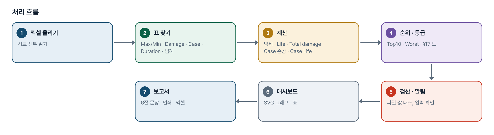
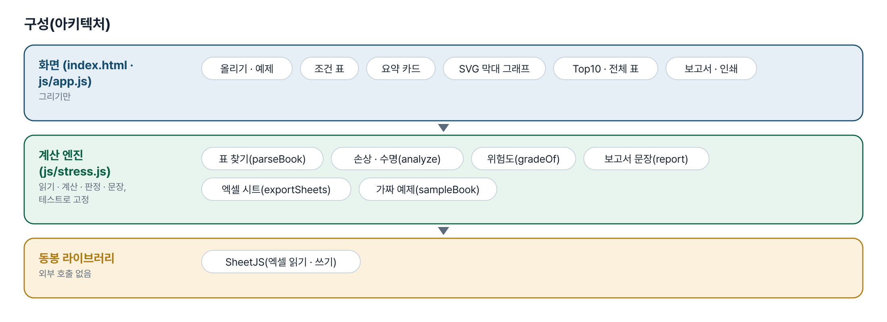
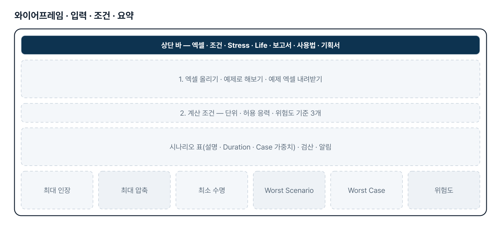
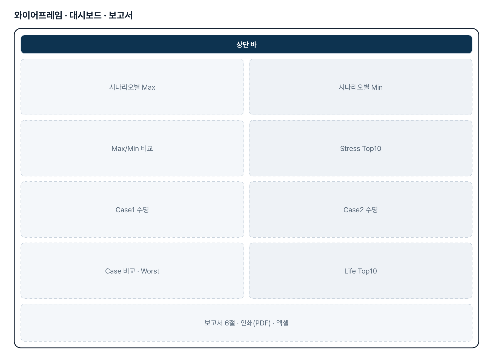
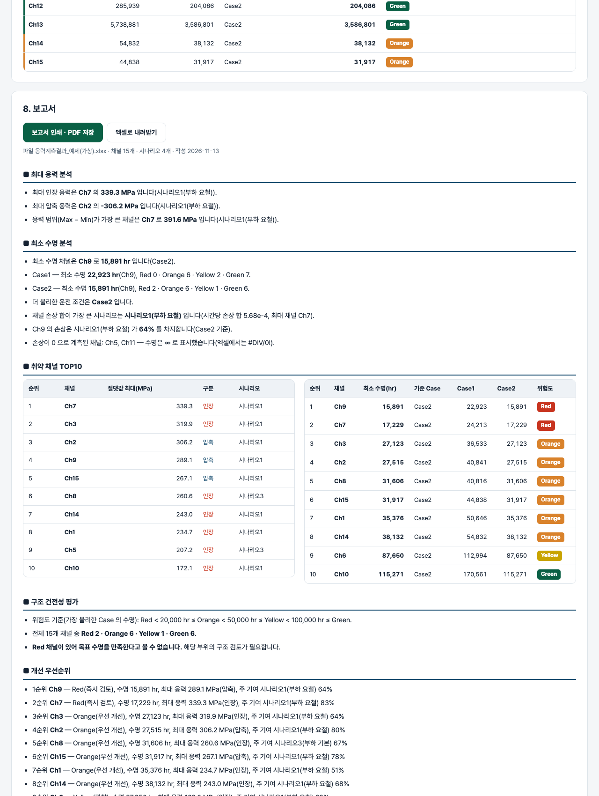

# 응력 계측 결과 후처리 대시보드 — 프로젝트 기획서 v1.1

- 기획: 노현석 · 작성일 2026-11-13 · 생성형 AI 업무자동화 전문가과정 · 2차수 프로젝트 16
- 바로 쓰기: https://build-2611-16.jobability.co.kr/
- 워드 판: `docs/기획서/build-2611-16_노현석_응력계측결과후처리대시보드_기획서_v1.1.docx`

## 개요

응력 계측 결과 엑셀(시나리오별 Max/Min Stress · Damage per hour · Case 가중치 · Duration time)을 올리면 응력 · 수명 대시보드와 취약 채널 TOP10, 위험도 평가, 6절 보고서를 만드는 브라우저 도구입니다. 계산식은 엑셀과 같고 파일에 적힌 값과 다시 계산한 값을 대조합니다.

### 배경 · 현재 업무
- 실차 응력 계측 뒤 채널 · 시나리오별 Max/Min 응력과 손상 · 수명을 엑셀로 정리하고 그래프와 보고서를 손으로 만듭니다.
- Claude 아티팩트로 대시보드를 만들어 보았지만 값이 화면에 박혀 있어, 엑셀에 값을 넣으면 그대로 바뀌는 도구가 필요했습니다. 코랩으로 옮기기는 어려웠습니다.
- 04번(계측 데이터 처리 · 3D 그래프)에 이은 같은 기획자의 두 번째 과제입니다.

### 목표
- 보내 주신 엑셀 배치를 그대로 읽습니다(시트 이름 · 표 위치 · 채널 수 · 시나리오 수는 달라도 됨).
- Stress Dashboard 6종과 Life Dashboard 5종을 한 화면에 그립니다.
- 최대 응력 채널 · 최소 수명 채널 · Worst Scenario · Worst Case · 위험도를 자동으로 뽑습니다.
- 6절 보고서를 계산 결과의 숫자로만 쓰고 인쇄(PDF) · 엑셀로 내보냅니다.

## 요구사항과 구현

| 기획서 요구 | 구현 |
|---|---|
| Excel 데이터 자동 분석 | SheetJS 로 시트 전부를 읽어 Max · Min 머리줄 표, Damage per hour 표, Case 가중치, Duration time, 시나리오 범례를 내용으로 찾음. 못 찾은 표는 알리고 그 분석만 뺌 |
| Stress Dashboard — Max · Min · 비교 그래프 | 채널 × 시나리오 묶음 막대(SVG) 2종 + 채널별 최대 인장 ~ 최대 압축 범위 막대 |
| 최대 응력 채널 · 최대 압축응력 채널 · Stress Top10 | 채널별 최대 인장 · 최대 압축 · 최대 범위와 시나리오, 절댓값 기준 Top10(인장/압축 구분) |
| Life Dashboard — Case1 · Case2 · 비교 그래프 | Case 별 수명 막대(막대 색 = 위험도, 기준 점선) + Case 묶음 막대. Case 수는 2개로 고정하지 않음 |
| Life Top10 · Worst Channel | 가장 불리한 Case 의 수명이 짧은 순 Top10, Worst Channel 과 그 채널의 시나리오별 손상 기여율 |
| 자동 분석 — Worst Scenario · Worst Case · 위험도 | Worst Scenario = 전 채널 시간당 손상 합 최대, Worst Case = 최소 수명이 가장 짧은 Case, 위험도 = Red/Orange/Yellow/Green |
| 위험도 평가 기준 | 기본 20,000 / 50,000 / 100,000 hr, 화면에서 변경 가능. 손상 0 은 ∞ · Green |
| 최종 보고서 6절 | 최대 응력 분석 · 최소 수명 분석 · 취약 채널 TOP10 · 구조 건전성 평가 · 개선 우선순위 · 종합 결론 — 규칙으로 만든 문장, 중요 수치 굵게, 표 포함 |
| 경영진 보고서 수준 · 그래프 포함 | 인쇄(PDF) 때 입력 · 조건 영역을 숨기고 요약 · 그래프 · 보고서만 2단으로 출력, 엑셀 4시트 내려받기 |
| 엑셀값을 넣으면 실행 · 추가 보완 | 예제 엑셀(입력 양식) 내려받기, Case 가중치 · Duration · 기준 · 허용 응력을 화면에서 바꿔 다시 계산, 파일 값과 재계산 값 검산 |

## 주요 기능

- **엑셀 읽기** — 표를 위치가 아니라 내용(머리글)으로 찾아 채널 · 시나리오 수가 달라도 읽습니다.
- **계산 조건** — Case 가중치 · Duration time · 위험도 기준 · 허용 응력을 바꾸면 바로 다시 계산합니다.
- **Stress Dashboard** — 시나리오별 Max · Min, 범위 비교, 최대 응력 채널, Top10.
- **Life Dashboard** — Case 별 수명과 비교, Top10, Worst Channel · Scenario · Case.
- **검산 · 알림** — 파일의 Case Life 와 재계산 대조, 가중치 합 · 가중치 머리글 순서 · 범례 중복 · Max/Min 뒤바뀜 알림.
- **보고서** — 6절 보고서, 인쇄(PDF) · 엑셀.

## 처리 흐름(파이프라인)

1. **엑셀 올리기** — 시트 전부 읽기
2. **표 찾기** — Max/Min · Damage · Case · Duration · 범례
3. **계산** — 범위 · Life · Total damage · Case 손상 · Case Life
4. **순위 · 등급** — Top10 · Worst · 위험도
5. **검산 · 알림** — 파일 값 대조, 입력 확인
6. **대시보드** — SVG 그래프 · 표
7. **보고서** — 6절 문장 · 인쇄 · 엑셀

## 구성(아키텍처)

- **화면 (index.html · js/app.js)** — 올리기 · 예제 · 조건 표 · 요약 카드 · SVG 막대 그래프 · Top10 · 전체 표 · 보고서 · 인쇄
- **계산 엔진 (js/stress.js)** — 표 찾기(parseBook) · 손상 · 수명(analyze) · 위험도(gradeOf) · 보고서 문장(report) · 엑셀 시트(exportSheets) · 가짜 예제(sampleBook)
- **동봉 라이브러리** — SheetJS(엑셀 읽기 · 쓰기)

## 화면 구성(와이어프레임)

## 규칙 · 판정 기준

- 표는 위치가 아니라 내용으로 찾습니다. Max · Min 표가 없으면 읽지 않고, 다른 표가 없으면 그 분석만 빼고 알립니다.
- 빈 칸 · 오류 값(#DIV/0!)은 「값 없음」입니다. 0 과 구분합니다.
- Life = 1 ÷ Damage per hour. 손상이 0 이면 ∞(손상 없음)로 두고 Green 으로 봅니다.
- Case Damage per hour = Σ(시나리오 Damage per hour × 가중치), 엑셀 수식과 같이 열 순서대로 곱합니다. 가중치 머리글과 시나리오 설명 순서가 다르면 계산은 그대로 하고 알립니다.
- 채널 위험도는 가장 불리한 Case 의 수명으로 매깁니다. 경계값은 Red < a ≤ Orange < b ≤ Yellow < c ≤ Green.
- Stress Top10 은 절댓값 최대 기준, Life Top10 은 수명이 짧은 순입니다.
- Worst Scenario = 전 채널 시간당 손상 합이 가장 큰 시나리오, Worst Case = 최소 수명이 가장 짧은 Case.
- 보고서의 숫자는 계산 결과에서만 가져옵니다. 수명 자료가 없으면 등급 · 우선순위를 쓰지 않습니다.
- 허용 응력을 넣지 않으면 안전율을 만들지 않습니다.

## 검증

- 계산 규칙 테스트 48개 · 화면 연기 테스트 24개 통과
- 계산 규칙 48개 — 표 찾기, 숫자 읽기, 범위 · Life · Total damage · Case 손상 · 기여율, 위험도 경계값, 순위, 검산, 알림, 빠진 표, 보고서 문장, 엑셀, 예제.
- 일부러 깨뜨려 확인 — Case 가중치 곱을 바꾸면 11개, 위험도 경계를 ≤ 로 바꾸면 1개가 실패합니다.
- 화면 24개 — 예제 → 그래프 막대 수 · Top10 · 보고서 → 가중치 · 기준 · 허용 응력 변경 → 예제 엑셀 내려받아 다시 올리기 → 결과 엑셀 → 응력만 있는 파일 · 표 없는 파일 → 390 · 768px 넘침 없음.
- 기획자가 보낸 실제 엑셀을 로컬에서 읽어 채널 15 · 시나리오 4 · Case 2 를 읽고 파일의 Case Life 26개와 재계산이 모두 같은 것을 확인했습니다(값은 저장소에 넣지 않음).

## 이번 판에서 하지 않는 것

- 기획자가 만든 Claude 아티팩트는 공개 링크가 열리지 않아 화면을 보지 못했습니다. 패들릿의 프롬프트와 엑셀 구조만으로 만들었습니다.
- 보고서 문장은 규칙으로 만듭니다. AI 가 원인 분석이나 개선안을 쓰지 않습니다.
- Word 파일로는 내보내지 않습니다. 인쇄(PDF)와 엑셀입니다.
- S-N 선도 · Rainflow 로 손상을 직접 계산하지 않습니다. 계측 소프트웨어가 낸 Damage per hour 를 입력으로 씁니다.
- 엑셀 안의 그림 · 차트(Gage Map 등)는 읽지 않습니다.

## 다음 단계

- 기획자 아티팩트 화면을 받아 빠진 그래프 · 표 맞추기
- 가중치 표의 머리글 순서(무부하 · 부하 × 기본 · 요철)와 시나리오 범례 확인 결과 반영
- 채널 위치 · 부위 이름 열, Gage Map 그림 연결
- 계측 회차를 여러 개 올려 수명 변화 비교

## 버전 이력

- **v1.1** (2026-11-13) — 기획자 추가 요청(패들릿 2026-11-12 PPT 3쪽) 반영 / Stress Dashboard — 시나리오 Show/Hide, 한 그래프에 겹쳐 비교 ↔ 시나리오마다 따로, 창마다 채널 선택 · 한 화면 채널 수 · 쪽 넘기기, 막대 위 값 표시(정수 · 소수점 1 · 2자리), 막대 ↔ 꺾은선, 그래프는 한 줄에 하나씩 크게. Max/Min 비교의 인장 빨강 · 압축 파랑은 유지 / Life Dashboard — Case 별 · 시나리오별 수명 평가, Case/시나리오 Show/Hide, Life 기준 오름 · 내림차순, Worst Channel Top 5 · 10 · 20, 채널 검색, 값 표시, 선형 ↔ 로그 축, 숫자는 300,000 처럼, 막대에 올리면 Channel · Case/Scenario · Life · Damage, 막대를 누르면 Stress Dashboard 가 그 채널만 / Damage Dashboard 신설 — Life 와 같은 보기 조건 / 채널별 표를 응력 · 손상 · 수명 세 표로 나눔 — 시나리오 이름은 한 줄 위, 「최대 범위」 → 「Stress range」, 손상 0 채널은 「Damage 0 (검증 필요)」
- **v1.0** (2026-11-12) — 첫 판 — 엑셀 읽기, Stress · Life 대시보드, 자동 분석, 위험도, 6절 보고서 / Case 가중치 · Duration · 기준 · 허용 응력을 화면에서 바꿔 다시 계산 / 파일의 Case Life 와 재계산 검산, 가중치 머리글 순서 · 범례 중복 알림 / 인쇄(PDF) · 엑셀 4시트, 계산 테스트 48 · 화면 테스트 24
